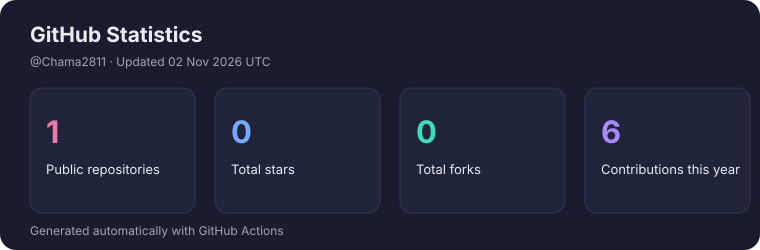
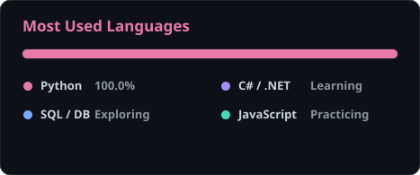
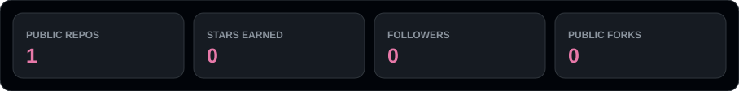
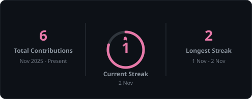
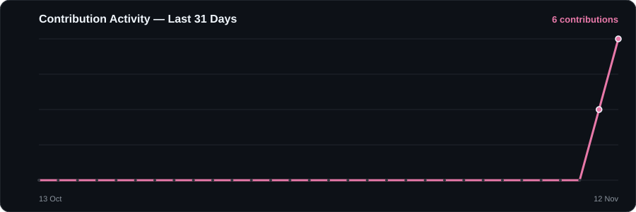

# Hi, I'm Chamathka Shehani! 🌸

### Data Science Undergraduate | Aspiring Software Developer

  

&nbsp;

---

## 🌷 About Me

Data Science undergraduate with a passion for software development, data analytics, and turning complex problems into intuitive digital solutions.

- 🎓 **Academic Path:** BSc in Data Science
- 📜 **Professional Diploma:** Higher Diploma in Computing & Software Engineering
- 💻 **Tech Interests:** Full-Stack Web Development, Data Analytics, and Intelligent Machine Learning
- 🌱 **Current Focus:** Sharpening data engineering, modern web frameworks, and predictive modeling
- 💡 **Philosophy:** *"Learning, building, and improving — one step at a time."*

---

## 🛠️ Tech Stack & Tools

### 💻 Programming Languages

  

### ⚛️ Frameworks & Libraries

  

### 🗄️ Databases

  

### 📊 Data Science & Analytics

  
  
  

### 🔧 Development Tools

  

---

## 🚀 Featured Projects

I believe in active learning through building hands-on projects across software engineering and data science.

| Focus Domain | Core Concepts & Capabilities | Tech Stack | Status |
| :--- | :--- | :--- | :--- |
| 📊 **Data Visualization & Analytics** | Exploratory data analysis, KPI dashboards, and data-driven storytelling. | `Python` `Tableau` `Power BI` | 🚀 Active Learning |
| 💻 **Full-Stack Web Development** | Responsive, dynamic user interfaces connected to reliable backend services & APIs. | `React` `.NET` `Node.js` `MySQL` | 🛠️ In Progress |
| 🤖 **AI & Machine Learning** | Predictive models, pattern recognition, and data intelligence algorithms. | `Python` `NumPy` `Pandas` `Scikit-Learn` | 🌱 Exploring |

👉 **Explore my latest repositories:** [github.com/Chama2811](https://github.com/Chama2811?tab=repositories)

---

## 📊 GitHub Analytics

### ⚡ Auto-Updating Repository Metrics

---

## 🔥 Contribution Streak

---

## 📈 Contribution Activity Graph

---

## 🐍 Contribution Activity

  <picture>
    <source media="(prefers-color-scheme: dark)" srcset="https://raw.githubusercontent.com/Chama2811/Chama2811/output/github-snake-dark.svg" />
    
  </picture>

---

## 🌱 Currently Learning & Exploring

  
  
  
  
  

- 🧠 Machine learning algorithms and statistical data modeling
- 🌐 Modern full-stack architecture with .NET and React
- 📈 Advanced data visualization and dashboard design using Tableau and Power BI
- 🗄️ Relational and NoSQL database management and optimization
- 🤝 Open-source contributions, Git workflows, and collaborative development

---

## 🤝 Let's Connect!

I'm always open to discussing technology, collaborating on interesting projects, or exchanging ideas.

<!-- Replace 'your-username' with your LinkedIn handle (e.g., https://www.linkedin.com/in/chamathka-shehani/) -->

&nbsp;

&nbsp;

  

### ✨ *"Learning, Building, Improving — One Step at a Time."* 🌸

